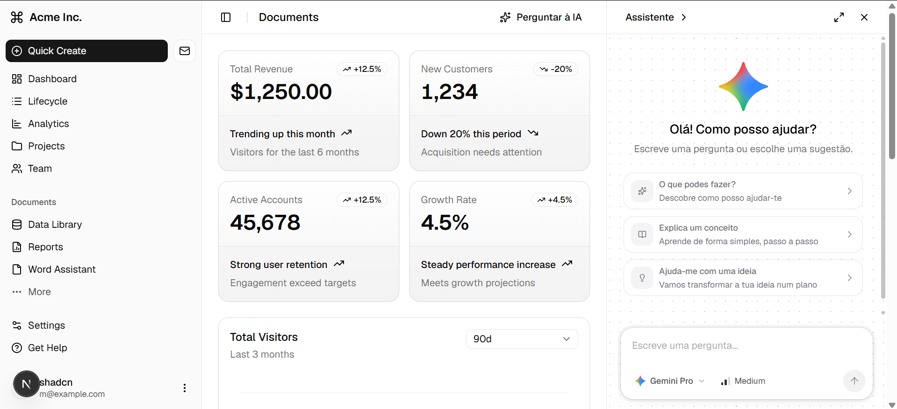

## Prompt para copiar e colar no teu agente de programação

Copia o bloco abaixo e cola-o no teu agente de programação com o projeto aberto:

```text
Analyze this project and make the ChatIA component ready to use. Use this README as a guide, adapting the steps to the project's structure and installed versions.

1. Before editing files, identify the framework, React version, Tailwind CSS setup, shadcn/ui configuration, aliases, existing components, and ThemeProvider. Preserve local changes and avoid refactoring unrelated parts of the application.
2. Configure the @react-bits and @kokonutui registries in components.json as described in this README, preserving the existing settings.
3. Install only missing pieces: DotGrid with `npx shadcn@latest add @react-bits/DotGrid-JS-CSS`, AI Input Selector with `npx shadcn@latest add @kokonutui/ai-prompt`, and the required shadcn button. Do not duplicate existing files or dependencies.
4. Integrate ChatIA at the appropriate entry point, wrapping the application content and keeping the ThemeProvider above it. Place the reusable `ChatIAButton` in the intended header; when a `SiteHeader` exposes a `btns` prop, use `const btn = <ChatIAButton />` and `<SiteHeader btns={btn} />`.
5. If the project uses Vite, configure the `@` alias and replace the `next/image` import with an image implementation that works in Vite. Do not add Next.js just to resolve that import. If the project uses Next.js, respect its client/server boundaries.
6. Do not invent a provider, endpoint, credentials, or real responses. Keep demo mode when no service is configured. If an endpoint already exists, connect through the server, protect credentials, and verify how assistant responses appear in the conversation history.
7. Run checks appropriate for the project, fix issues caused by the integration, and leave unrelated files unchanged.
8. Summarize the changed files, how to open and use the chat, the checks performed, and any AI service configuration that is still needed. Do not commit or push.
```

# ChatIA

`ChatIA` é um componente React de chat que se integra ao conteúdo da aplicação. Mostra uma janela lateral ou flutuante, sugestões para iniciar uma conversa, histórico local e um campo de entrada com seletor de modelo.

O componente é código do projeto, não um serviço de IA. Sem `onSubmit`, usa uma resposta de demonstração; para conversar com um modelo real, a aplicação precisa fornecer a ligação ao seu próprio servidor.

## De onde vêm os elementos

- **Campo de entrada e seletor de modelo:** [AI Input Selector, Kokonut UI](https://kokonutui.com/docs/ai/ai-prompt).
- **Fundo animado de pontos:** [DotGrid, React Bits](https://reactbits.dev/r/DotGrid-JS-CSS.json).
- **Botões, menus, tema e utilitários:** [shadcn/ui](https://ui.shadcn.com/), com estilos de [Tailwind CSS](https://tailwindcss.com/).
- **Ícones e animações:** `lucide-react` e `motion`, usados pelo input e pela interface.

O `ChatIA` reúne essas peças e acrescenta o painel, as sugestões, o estado das conversas e a personalização visual.

## Requisitos

- React e uma aplicação cliente.
- Tailwind CSS e shadcn/ui configurados no projeto.
- Os aliases usados pelo código: `@/components`, `@/hooks` e `@/lib`.
- `components.json` configurado para os registos Kokonut UI e React Bits.
- Para o tema claro/escuro, um `ThemeProvider` compatível com `next-themes`.

O projeto atual usa Next.js 16, React 19 e Tailwind CSS 4. O componente usa `"use client"`, `localStorage`, `next-themes` e `next/image`.

## Instalação das peças

Inicializa shadcn/ui no projeto, se ainda não estiver configurado. Em `components.json`, mantém os aliases existentes e adiciona estes registos:

```json
{
  "registries": {
    "@kokonutui": "https://kokonutui.com/r/{name}.json",
    "@react-bits": "https://reactbits.dev/r/{name}.json"
  }
}
```

Executa os comandos a partir da raiz do projeto:

```bash
npx shadcn@latest add @react-bits/DotGrid-JS-CSS
npx shadcn@latest add @kokonutui/ai-prompt
npx shadcn@latest add button
```

O comando do Kokonut UI também instala os componentes shadcn que o input usa, como `dropdown-menu` e `textarea`. O `button` é usado diretamente pelo `ChatIA`. Se algum arquivo ou pacote já existir, conserva a implementação atual e instala apenas o que estiver em falta.

O comando React Bits instala o DotGrid em JavaScript com CSS. A estrutura local esperada inclui:

```text
components/
  chat-ia/chat-ia.tsx
  DotGrid.jsx
  DotGrid.css
  kokonutui/ai-prompt.tsx
  ui/button.tsx
  ui/dropdown-menu.tsx
  ui/textarea.tsx
hooks/use-auto-resize-textarea.ts
lib/utils.ts
```

As rotas dos registos são namespaced em `components.json`; o CLI shadcn usa essa configuração para descobrir cada componente. Consulta também a [instalação do Kokonut UI](https://kokonutui.com/docs) e a [instalação do React Bits](https://reactbits.dev/get-started/installation).

## Uso em Next.js

Importa `ChatIA` e coloca-o no layout raiz, envolvendo `{children}`. O `ThemeProvider` deve estar acima do componente para que a escolha de logo e cores acompanhe o tema:

```tsx
import { ChatIA } from "@/components/chat-ia/chat-ia";
import { ThemeProvider } from "@/components/theme-provider";

export default function RootLayout({
  children,
}: Readonly<{ children: React.ReactNode }>) {
  return (
    <html lang="pt" suppressHydrationWarning>
      <body>
        <ThemeProvider>
          <ChatIA
            logoIa="https://cdn.jsdelivr.net/gh/homarr-labs/dashboard-icons/svg/google-gemini.svg"
            logoIaDark="https://cdn.jsdelivr.net/gh/homarr-labs/dashboard-icons/svg/google-gemini.svg"
            logoIaSize={70}
            name="Assistente"
            color="#F2A900"
            borderColor="var(--border)"
            floating={false}
            floatingMargin={5}
            floatingRadius={24}
            floatingShadow={false}
            floatingMarginLeft={15}
          >
            {children}
          </ChatIA>
        </ThemeProvider>
      </body>
    </html>
  );
}
```

`children` é o conteúdo normal do site. Com `floating={false}`, o chat abre como painel lateral e reduz a largura do conteúdo enquanto está aberto. Com `floating`, abre como painel flutuante sobre a página.

## Botão para abrir o chat

`ChatIAButton` abre o painel e pode ser colocado em qualquer ponto dentro de `ChatIA`. No `SiteHeader`, passa-o pela propriedade `btns`:

```tsx
import { ChatIAButton } from "@/components/chat-ia/chat-ia";
import { SiteHeader } from "@/components/site-header";

const btn = <ChatIAButton />;

<SiteHeader btns={btn} />
```

O botão mostra o ícone de estrelas e o texto `Perguntar à IA`.

## Propriedades

| Propriedade | Para que serve |
| --- | --- |
| `children` | Conteúdo da aplicação mostrado junto ao chat. Obrigatório. |
| `name` | Nome apresentado no cabeçalho e no seletor de conversas. Predefinição: `Chat IA`. |
| `logoIa`, `logoIaDark` | Logo para os temas claro e escuro; aceitam URL ou import estático do Next.js. |
| `logoIaSize` | Largura e altura do logo em píxeis. Predefinição: `56`. |
| `color` | Cor de destaque inicial. |
| `activeColor` | Substitui `color` como cor de destaque. |
| `borderColor` | Cor das bordas do painel e das mensagens. |
| `floating` | Abre um painel flutuante; por omissão é `false`. |
| `floatingMargin` | Margem padrão do painel flutuante; por omissão `16`. |
| `floatingMarginTop`, `floatingMarginRight`, `floatingMarginBottom`, `floatingMarginLeft` | Sobrescrevem individualmente as margens flutuantes. Aceitam número em píxeis ou valor CSS. |
| `floatingRadius` | Raio dos cantos do painel flutuante; por omissão `24`. |
| `floatingShadow` | Mostra sombra no painel flutuante; por omissão `true`. |
| `placeholder` | Texto do campo de entrada; por omissão `Escreve uma pergunta...`. |
| `models` | Modelos e níveis de esforço apresentados pelo input. |
| `defaultModel` | Modelo inicialmente selecionado. Por omissão: `Gemini Pro`. |
| `onSubmit` | Recebe o texto, o modelo e opções como `effort`, `signal` e `command` para a aplicação fazer a chamada ao seu serviço. |
| `onStop` | Callback opcional quando o utilizador interrompe uma resposta. |

Exemplo de configuração de modelos:

```tsx
const models = [
  {
    name: "Gemini Pro",
    description: "Modelo avançado para tarefas complexas",
    efforts: ["Low", "Medium", "High"],
    defaultEffort: "Medium",
  },
  {
    name: "Gemini Flash",
    description: "Modelo rápido para tarefas do dia a dia",
    efforts: ["Low", "Medium"],
    defaultEffort: "Medium",
  },
];

function ChatLayout({ children }: { children: React.ReactNode }) {
  return (
    <ChatIA models={models} defaultModel="Gemini Pro">
      {children}
    </ChatIA>
  );
}
```

## Conversas e ligação à IA

As conversas são guardadas em `localStorage` no navegador, na chave `chat-ia-conversations-v1`. O utilizador pode iniciar, selecionar, limpar e eliminar conversas. Esses dados ficam no navegador atual; o componente não os sincroniza com um servidor.

Enquanto aguarda uma resposta, o componente mostra o `AILoadingState`. Sem `onSubmit`, simula uma resposta de teste depois de enviar uma mensagem. Com `onSubmit`, recebe o texto, o nome do modelo e opções, incluindo `signal` para cancelamento. Usa esse callback para chamar uma rota do teu servidor e manter as chaves do fornecedor no servidor, nunca no código do browser. Se o callback devolver uma string, ela é apresentada no histórico como resposta do assistente; converte respostas estruturadas em texto antes de as devolver.

## Compatibilidade

| Ambiente | Compatibilidade |
| --- | --- |
| React | É um componente React cliente; depende dos componentes e dos aliases descritos acima. |
| Next.js | Integração direta no App Router, dentro de um `ThemeProvider`. |
| Vite | Requer configurar o alias `@` e Tailwind/shadcn. Esta cópia importa `next/image`; para usar em Vite, substitui essa importação por uma imagem HTML (`img`) ou por um adaptador compatível. Não foi validada uma build Vite neste repositório. |

Para iniciar um projeto Vite com shadcn/ui, consulta a [guia oficial do shadcn para Vite](https://ui.shadcn.com/docs/installation/vite). Os componentes Kokonut UI e React Bits são adicionados como código React e Tailwind pelo CLI shadcn.

## Referências

- [AI Input Selector — Kokonut UI](https://kokonutui.com/docs/ai/ai-prompt)
- [DotGrid — registo React Bits](https://reactbits.dev/r/DotGrid-JS-CSS.json)
- [Instalação React Bits](https://reactbits.dev/get-started/installation)
- [shadcn/ui — registos namespaced](https://ui.shadcn.com/docs/registry/namespace)
- [shadcn/ui — Vite](https://ui.shadcn.com/docs/installation/vite)
